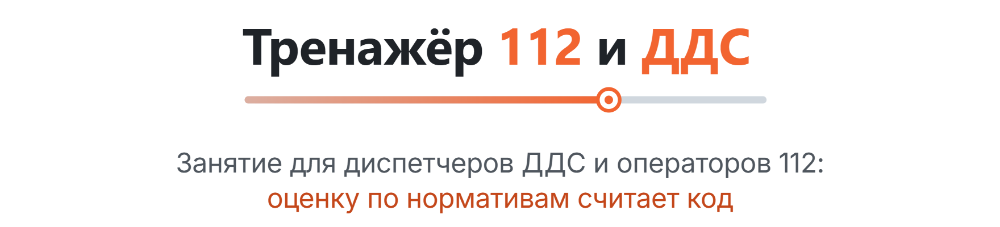
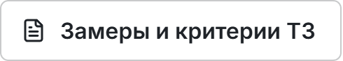
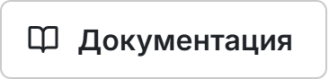
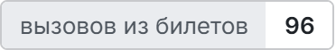
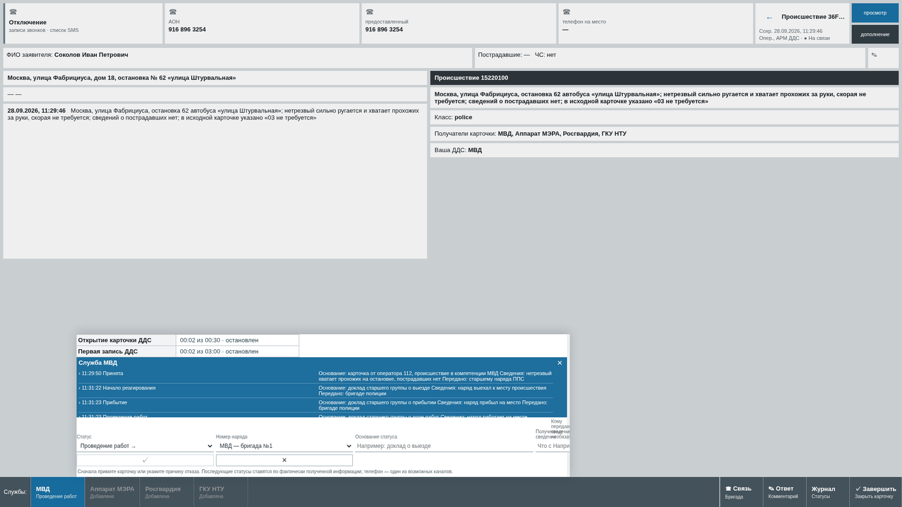
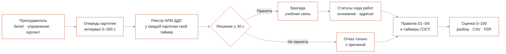
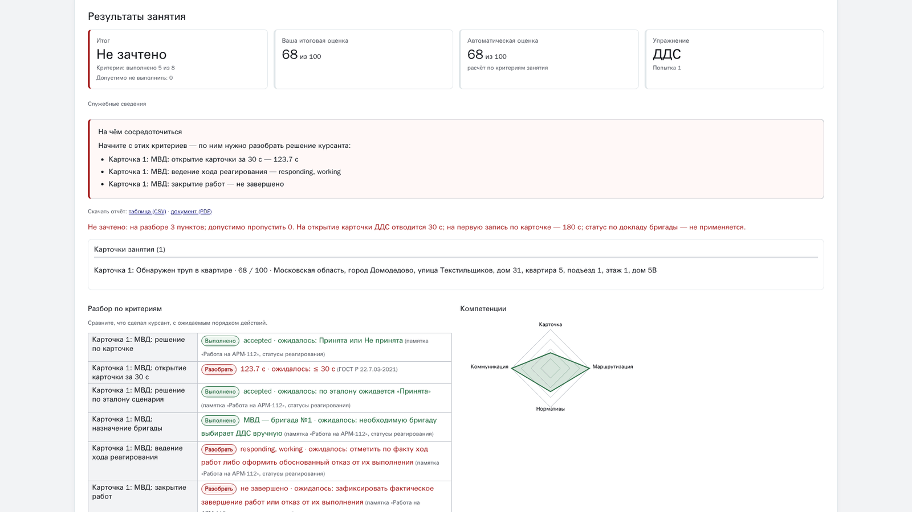
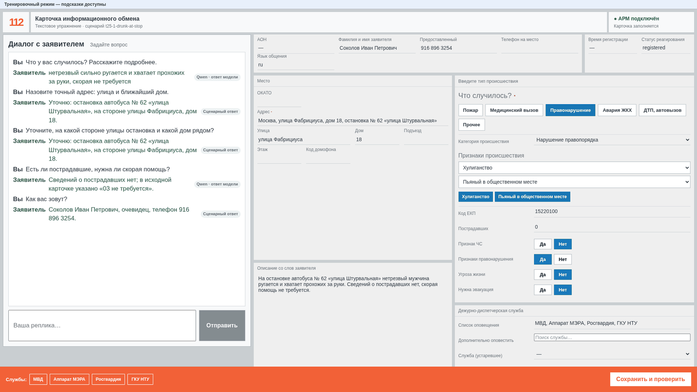

<p align="center">
  <picture>
    <source media="(prefers-color-scheme: dark)" srcset="docs/readme/banner.dark.png">
    
  </picture>
</p>

<p align="center">
  Преподаватель выдаёт карточки из билетов заказчика, курсант за 30 секунд принимает решение и ведёт
  реагирование своей службы, а система объясняет каждый снятый балл ссылкой на норматив. Всё работает локально, без сети.
</p>

<p align="center">
  <!-- readme:buttons -->
  <a href="#запуск"><picture><source media="(prefers-color-scheme: dark)" srcset="docs/readme/cta-run.dark.png"></picture></a>
  <br>
  <a href="docs/measurements.md"><picture><source media="(prefers-color-scheme: dark)" srcset="docs/readme/cta-measurements.dark.png"></picture></a>
  <a href="docs/README.md"><picture><source media="(prefers-color-scheme: dark)" srcset="docs/readme/cta-docs.dark.png"></picture></a>
  <!-- /readme:buttons -->
</p>

<p align="center">
  <!-- readme:status -->
  <a href="#как-это-работает"><picture><source media="(prefers-color-scheme: dark)" srcset="docs/readme/badge-status-1.dark.png"></picture></a>
  <a href="#зачем-это"><picture><source media="(prefers-color-scheme: dark)" srcset="docs/readme/badge-status-2.dark.png"></picture></a>
  <br>
  <a href="#результаты"><picture><source media="(prefers-color-scheme: dark)" srcset="docs/readme/badge-status-3.dark.png"></picture></a>
  <a href="#запуск"><picture><source media="(prefers-color-scheme: dark)" srcset="docs/readme/badge-status-4.dark.png"></picture></a>
  <a href="LICENSE"><picture><source media="(prefers-color-scheme: dark)" srcset="docs/readme/badge-status-5.dark.png"></picture></a>
  <!-- /readme:status -->
</p>

<p align="center">
  <!-- readme:stack -->
  <picture><source media="(prefers-color-scheme: dark)" srcset="docs/readme/badge-stack-1.dark.png"></picture>
  <picture><source media="(prefers-color-scheme: dark)" srcset="docs/readme/badge-stack-2.dark.png"></picture>
  <br>
  <picture><source media="(prefers-color-scheme: dark)" srcset="docs/readme/badge-stack-3.dark.png"></picture>
  <picture><source media="(prefers-color-scheme: dark)" srcset="docs/readme/badge-stack-4.dark.png"></picture>
  <picture><source media="(prefers-color-scheme: dark)" srcset="docs/readme/badge-stack-5.dark.png"></picture>
  <!-- /readme:stack -->
</p>

<p align="center">
  <!-- readme:nav -->
  <a href="#зачем-это"><picture><source media="(prefers-color-scheme: dark)" srcset="docs/readme/badge-nav-1.dark.png"></picture></a>
  <a href="#как-это-работает"><picture><source media="(prefers-color-scheme: dark)" srcset="docs/readme/badge-nav-2.dark.png"></picture></a>
  <a href="#попробовать-за-две-минуты"><picture><source media="(prefers-color-scheme: dark)" srcset="docs/readme/badge-nav-3.dark.png"></picture></a>
  <br>
  <a href="#результаты"><picture><source media="(prefers-color-scheme: dark)" srcset="docs/readme/badge-nav-4.dark.png"></picture></a>
  <a href="#запуск"><picture><source media="(prefers-color-scheme: dark)" srcset="docs/readme/badge-nav-5.dark.png"></picture></a>
  <a href="#устройство"><picture><source media="(prefers-color-scheme: dark)" srcset="docs/readme/badge-nav-6.dark.png"></picture></a>
  <a href="#ограничения"><picture><source media="(prefers-color-scheme: dark)" srcset="docs/readme/badge-nav-7.dark.png"></picture></a>
  <!-- /readme:nav -->
</p>

<p align="center">
  
  <br>
  <sub>АРМ ДДС на карточке из билета 25: оба таймера остановлены в норме, служба МВД ведёт статусы хода работ с основанием и адресатом.</sub>
</p>

## Зачем это

Диспетчеров ДДС и операторов 112 сейчас готовят по памятке и билетам вручную: преподаватель
зачитывает вводную, курсант заполняет бумажную карточку, время засекают на глаз. Специального
ПО для этого нет, российских открытых аналогов мы не нашли.

Это тренажёр занятия, а не одного звонка. Преподаватель выдаёт готовые карточки из 96 вызовов
32 билетов заказчика. Курсант-диспетчер за 30 секунд принимает карточку или мотивированно
отказывает, выбирает бригаду и ведёт статусы хода работ. Система засекает время, находит
ошибки D1–D6 из памятки АРМ-112 и ставит оценку, где у каждого снятого балла есть факт,
норматив и рекомендация.

Нормативы взяты из первоисточников. 30 с на открытие карточки ДДС — ПП РФ № 1931 и памятка
АРМ-112. Ответ на вызов 8 с, опрос 75 с, оповещение ДДС 60 с — ГОСТ Р 22.7.03-2021. Список
оповещения строится по классификатору ЕКП v046.24 (1283 кода).

Второе упражнение — оператор 112 по текстовой вводной: опросная карта, карточка
информационного обмена (КИО), список оповещения по ЕКП и передача в ДДС. Живой голосовой
заявитель — дополнительный режим поверх него.

## Как это работает



- **Баллы считает код.** Оценка — детерминированные правила: факт против норматива, код
  ошибки, обоснование. LLM-судьи нет. Qwen играет заявителя и пишет черновики сценариев,
  Vikhr — рекомендации к уже проваленным критериям. Преподаватель может поправить итог только
  с обоснованием и записью в аудит.
- **Таймер останавливает событие.** Таймер ГОСТ останавливается действием курсанта, а не
  таймаутом клиента. Время фиксирует сервер в UTC, поэтому каждую просрочку в отчёте можно
  предъявить.
- **Всё локально.** Модели, телефония и база живут на одной машине. В офлайн-режиме нелокальный
  адрес модели отвергается. Основной путь ДДС вообще не требует моделей.

| Код | Ошибка из памятки АРМ-112 |
|---|---|
| D1 | Статус реагирования не проставлен, карточка ушла в «Не оповещено»; карточка открыта позже 30 с |
| D2 | Статус не соответствует факту: «Принята» там, где работы не ведутся, и наоборот |
| D3 | Отказ от профильного происшествия вопреки эталону сценария |
| D4 | Отказ без комментария |
| D5 | Неполный комментарий: не назван получатель переданных сведений |
| D6 | Нет статусов хода работ: начало, прибытие, завершение |

## Попробовать за две минуты

После [запуска](#запуск) войдите преподавателем на <http://127.0.0.1:5173>.

| Шаг | Экран | Что увидите |
|---|---|---|
| 1 | `/instructor`, пульт преподавателя | Фильтры по билету, категории ЕКП и сложности; «Начать занятие» выдаёт ссылку на АРМ курсанта |
| 2 | `/dds`, реестр АРМ ДДС | Карточки поступают по одной, у каждой свой таймер 30 с |
| 3 | Карточка ДДС | «Принята» или «Не принята»; отказ без причины не сохраняется, бригаду выбирает курсант |
| 4 | Ход работ | Статусы с основанием и адресатом; «Связь» открывает учебный звонок через Asterisk |
| 5 | Результаты занятия | Итог, балл, разбор по каждому критерию со ссылкой на норматив, профиль компетенций |

<p align="center">
  
  <br>
  <sub>Шаг 2. Две карточки в работе одновременно, таймер каждой идёт независимо.</sub>
</p>

<p align="center">
  
  <br>
  <sub>Шаг 5. Прогон с ошибками нарочно: открытие карточки через 123,7 с при нормативе 30 с, каждая строка со ссылкой на источник.</sub>
</p>

<details>
<summary><b>Упражнение 112: вводная → КИО → список оповещения</b></summary>
<br>
<p align="center">
  
  <br>
  <sub>Курсант опрашивает заявителя и заполняет КИО, код ЕКП выбирает список служб для оповещения.</sub>
</p>
</details>

## Результаты

Все прогоны сняты на машине разработки. Полная таблица и сверка с критериями ТЗ —
в [замерах](docs/measurements.md).

| Цифра | Что показывает |
|---|---|
| **746 passed**, 8 skipped | Полный прогон бэкенда на чистой PostgreSQL (`make test-db`) |
| **p95 946,74 мс**, 100/100 | 20 занятий и 100 учётных записей за Nginx при подключении в течение 2 с |
| **17,87 с**, 100/100 каналов | Узел убит под нагрузкой 20×100, все занятия перешли на второй узел |
| **13 288** записей/с | Журнал аудита PostgreSQL; требование ТЗ — от 100 операций/с |
| **0,19 с** | PDF-отчёт после перезапуска backend; норматив ТЗ — 30 с |
| **2,57 с** до соединения | Два браузера по WebRTC через локальный Asterisk |
| **0 утечек** на 96 карточках | Провокационные вопросы локальному Qwen не выдали скрытых фактов сценария |

## Запуск

Нужен Docker на x86-64. Образы собраны заранее, `.env` не обязателен:

```bash
docker compose up
make users-docker
```

Первая команда поднимает базу, backend, фронт, Asterisk, Qwen и Vikhr. Вторая создаёт учётки
admin, teacher и trainee и печатает пароли один раз. Стенд открывается на
<http://127.0.0.1:5173> и слушает только локальный адрес. Когда образы скачаны, `make offline`
поднимает его без сети.

Показ без Docker и моделей, тесты и остальные команды — в [руководстве разработчика](docs/development.md).

## Устройство

```text
backend/app/domain/   контракт: КИО, события, таймеры, статусы ДДС, ЕКП, таксономия ошибок
backend/app/scoring/  правила оценки и нормативы
frontend/             АРМ ДДС, АРМ 112, пульт, монитор, профиль
scenarios/tickets/    96 вызовов из билетов заказчика
sip/                  локальный Asterisk: SIP и WebRTC
deploy/               образ LLM и лицензии весов
```

TypeScript-типы фронта генерируются из Pydantic-моделей бэкенда, расхождение ловит тест.
Курсант не получает ни фактов сценария, ни эталона.

<p align="center">
  
  <br>
  <sub>Пульт: занятие собирается из билета заказчика, упражнение выбирается явно.</sub>
</p>

## Ограничения

- **Отклик ≤ 2 с при одновременном старте 100 интерфейсов не выполнен.** Порог держится, когда
  подключение растянуто на 2 с; при старте всех сразу p95 — от 2,3 до 3,3 с.
- **Целевой сервер 6 ядер / 32 ГБ не испытывался.** Все цифры сняты на машине разработки.
- **Windows 10/11 не проверялся**, установки на ПК заказчика не было.
- **AD/LDAP проверен только на заглушках.**
- **Телефония проверена только на localhost** с синтетическим звуком браузера. Речь в
  SIP-звонке не распознаётся и не оценивается.
- **Голосовой заявитель — дополнительный режим:** время LLM до первой фразы не измерено.
- **Методику не утверждал заказчик.** Веса критериев, вклад времени в балл и эталонные отказы
  по 96 билетам — допущения команды. Из 15 условий списка оповещения ЕКП из КИО выводятся 5.
- **Двухузловый режим не закрыт до конца:** доставка «ровно один раз» для всех команд канала
  не заявляется.

<p align="center">
  <picture><source media="(prefers-color-scheme: dark)" srcset="docs/readme/mark.dark.png"></picture>
  <br>
  <sub>Команда Ullax, хакатон «Лидеры цифровой трансформации», задача № 9, 2026. Код под лицензией <a href="LICENSE">MIT</a>.<br>
  Веса моделей не изменялись и идут по своим лицензиям, Silero TTS — только некоммерческое использование: <a href="deploy/licenses/NOTICE.md">deploy/licenses</a>. Built with Llama.</sub>
</p>
