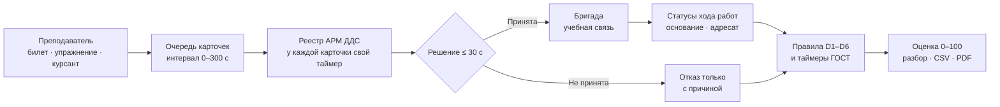
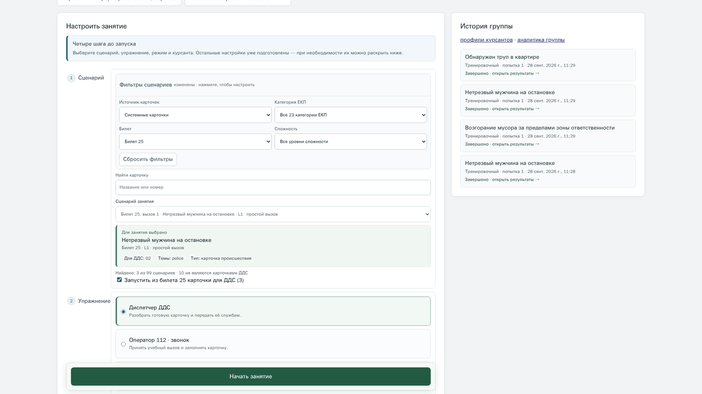
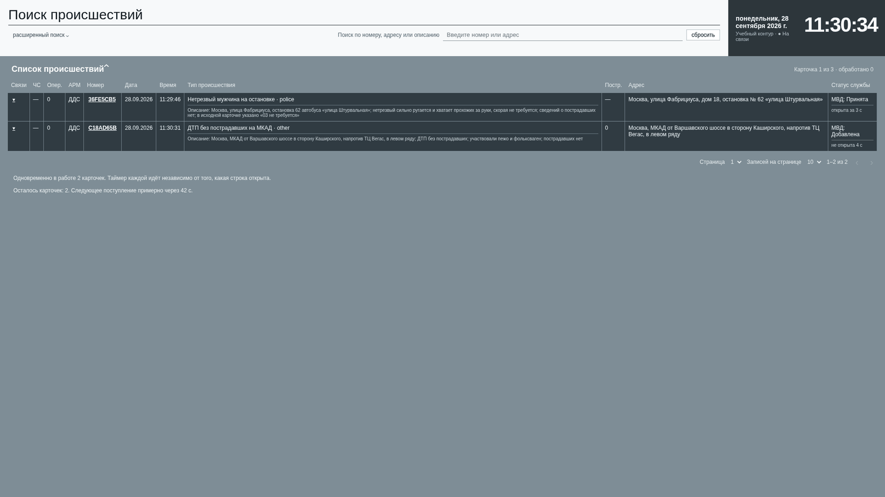

<p align="center">
  <picture>
    <source media="(prefers-color-scheme: dark)" srcset=".github/assets/wordmark-dark.svg"/>
    
  </picture>
</p>

<p align="center">
  <b>Тренажёр занятия для диспетчеров ДДС и операторов 112: карточка, 30 секунд на решение,<br/>  оценка по нормативам, которую считает код.</b><br/>
  Преподаватель выдаёт карточки из билетов заказчика, курсант отрабатывает реагирование своей службы,<br/>  система объясняет каждый снятый балл ссылкой на норматив. Всё работает локально, без сети.
</p>

<p align="center">
  <a href="#запуск"></a>
  <a href="#критерии-тз"></a>
</p>

<p align="center">
  <a href="#идея"></a>
  <a href="#три-решения"></a>
  <a href="#как-устроено"></a>
  <a href="#посмотреть-за-2-минуты"></a>
  <a href="#что-измерено"></a>
  <a href="#критерии-тз"></a>
  <a href="#запуск"></a>
  <a href="#ограничения"></a>
</p>

<p align="center">
  
  
  
  
  
  
  
</p>

<p align="center">
  
</p>

<p align="center"><sub>АРМ ДДС на карточке из билета 25: оба таймера остановлены в норме, служба МВД ведёт статусы «Принята → Начало реагирования → Прибытие → Проведение работ» с основанием и адресатом.</sub></p>

---
## Идея

Диспетчеров ДДС и операторов 112 сейчас готовят по памятке и билетам вручную: преподаватель
зачитывает вводную, курсант заполняет бумажную карточку, время засекают на глаз. Специального
ПО для этого нет, российских открытых аналогов мы не нашли.

Мы строим **тренажёр занятия, а не одного звонка**. Преподаватель выдаёт готовые карточки из
96 вызовов 32 билетов заказчика. Курсант-диспетчер за 30 секунд принимает карточку или
мотивированно отказывает, выбирает бригаду и ведёт статусы хода работ своей службы. Система
засекает время, находит ошибки D1–D6 из памятки АРМ-112 и ставит числовую оценку, где у каждого
снятого балла есть факт, норматив и рекомендация.

> **Нормативы — из первоисточников, а не собственных шкал.** 30 с на открытие карточки ДДС —
> ПП РФ № 1931 и памятка АРМ-112. Ответ на вызов 8 с, опрос 75 с, оповещение ДДС 60 с —
> ГОСТ Р 22.7.03-2021. Список оповещения строится по классификатору ЕКП v046.24 (1283 кода).

Второе упражнение — **оператор 112 по текстовой вводной**: опросная карта → карточка
информационного обмена (КИО) → список оповещения по ЕКП → передача в ДДС. Живой голосовой
заявитель — дополнительный режим поверх, он не подменяет цикл ДДС.

## Три решения

<table>
<tr>
<td valign="top" width="33%">

**Баллы считает код**

Оценка — детерминированные правила: факт против норматива, код ошибки, обоснование. LLM-судьи
нет. Qwen играет заявителя и пишет черновики сценариев, Vikhr — рекомендации к уже проваленным
критериям. Итог преподаватель может поправить, только с обоснованием и записью в аудит.

</td>
<td valign="top" width="33%">

**Таймер останавливает событие**

Таймер ГОСТ останавливается действием курсанта — открытием карточки, первой записью, статусом,
— а не таймаутом клиента. Время фиксирует сервер в UTC, поэтому каждую просрочку в отчёте можно
предъявить: когда началось, чем закончилось, какой предел.

</td>
<td valign="top" width="33%">

**Всё локально**

Модели, телефония и база живут на одной машине. В офлайн-режиме нелокальный адрес модели
отвергается, а не молча подменяется заготовкой. Основной путь ДДС вообще не требует моделей.
После скачивания образов стенду сеть не нужна.

</td>
</tr>
</table>

## Как устроено



| Код | Ошибка из памятки АРМ-112 |
|---|---|
| D1 | Статус реагирования не проставлен, карточка ушла в «Не оповещено»; карточка открыта позже 30 с |
| D2 | Статус не соответствует факту: «Принята» там, где работы не ведутся, и наоборот |
| D3 | Отказ от профильного происшествия вопреки эталону сценария |
| D4 | Отказ без комментария |
| D5 | Неполный комментарий: не назван получатель переданных сведений |
| D6 | Нет статусов хода работ: начало, прибытие, завершение |

Контракт фронта и бэка — Pydantic-модели в [`backend/app/domain/`](backend/app/domain/):
КИО, события, таймеры, статусы ДДС, ЕКП, таксономия ошибок. TypeScript-типы фронта генерируются
из них (`make types`), расхождение ловит тест. Курсант не получает ни фактов сценария, ни
эталона: их не видно даже в DevTools.

## Посмотреть за 2 минуты

После [запуска](#запуск) войдите преподавателем на `http://127.0.0.1:5173`.

| Шаг | Экран | Что увидите |
|---|---|---|
| 1 | `/instructor` — пульт преподавателя | Фильтры по билету, категории ЕКП и сложности; упражнение «Диспетчер ДДС»; «Начать занятие» выдаёт ссылку на АРМ курсанта |
| 2 | `/dds` — реестр АРМ ДДС | Карточки поступают по одной, у каждой идёт свой таймер 30 с и видно, сколько карточек осталось |
| 3 | Карточка ДДС | «Принята» или «Не принята»; отказ без причины не сохраняется, бригаду выбирает сам курсант |
| 4 | Ход работ | Статусы с основанием и адресатом; «Связь» открывает учебный звонок старшему бригады через Asterisk |
| 5 | Результаты занятия | Итог, балл, «на чём сосредоточиться», разбор по каждому критерию со ссылкой на норматив, профиль компетенций |

<p align="center">
  
</p>
<p align="center"><sub>Шаг 1. Пульт: занятие собирается из билета заказчика, упражнение выбирается явно.</sub></p>

<p align="center">
  
</p>
<p align="center"><sub>Шаг 2. Реестр ДДС: две карточки в работе одновременно, таймер каждой идёт независимо.</sub></p>

<p align="center">
  
</p>
<p align="center"><sub>Шаг 5. Прогон с ошибками нарочно: система поймала открытие карточки через 123,7 с при нормативе
30 с и пропущенные статусы хода работ — каждая строка со ссылкой на источник.</sub></p>

<details>
<summary><b>Упражнение 112: вводная → КИО → список оповещения</b></summary>
<br/>
<p align="center">
  
</p>
<p align="center"><sub>Курсант опрашивает заявителя, заполняет КИО, код ЕКП выбирает список служб для оповещения.
Реплики с пометкой «Qwen» написала локальная модель, остальные — из сценария.</sub></p>
</details>

## Что измерено

Все прогоны — на машине разработки.

| Цифра | Что показывает |
|---|---|
| **746 passed**, 8 skipped | Полный прогон бэкенда на чистой PostgreSQL (`make test-db`): пропуски — голосовые тесты без моделей |
| **p95 946,74 мс**, 100/100 страниц | 20 занятий и 100 разных учётных записей за Nginx, подключение в течение 2 с, ошибок нет |
| **p95 1187,08 мс**, 100/100 | То же на двух backend-узлах за Nginx с привязкой сессии к узлу |
| **17,87 с**, 100/100 каналов | SIGKILL одного узла под нагрузкой 20×100: все 20 занятий переходят на второй узел, каналы восстановлены за 18,30 с |
| **11,19 с**, 27/27 проверок | Узел теряет связь с БД: второй узел забирает занятие, старый отстранён от записи (fencing epoch 1 → 2) |
| **97,9 и 99,0** из 100 | Карточка ДДС начата до отказа узла и закончена после; все пять статусов записаны ровно один раз |
| **2,25 с** после обрыва 30 с | Nginx недоступен 30 с; после возврата WSS переподключился, неподтверждённая правка КИО дошла до сервера |
| **13 288** записей/с | Запись в журнал аудита PostgreSQL при 20 соединениях; требование ТЗ — от 100 операций/с |
| **0,19 с** | Формирование PDF-отчёта после перезапуска backend; норматив ТЗ — 30 с |
| **p95 RTT 1,5 мс**, 29 пакетов | SIP/RTP на локальном Asterisk: REGISTER, Echo-вызов, BYE (`make sip-test`) |
| **2,57 с** до соединения | Два браузера 6101 ↔ 6102 по WebRTC, аудиотрек у обеих сторон, запись WAV (`make webrtc-test`) |
| **0 утечек** на 96 карточках | Провокационные вопросы локальному Qwen: скрытые факты сценария не выданы, 11 ответов из 96 заменены заготовкой |
| **0 переполнений** на 390 px | 7 экранов курсанта и преподавателя в мобильной ширине, нет контролов меньше 40 px и JS-ошибок |
| STT **≈ 0,29 с**, TTS **0,14–0,17 с** | GigaAM v3 на фразе 2 с и Silero на реплике; время LLM до первого предложения не измерено |

## Критерии ТЗ

<details>
<summary><b>Где закрыт каждый ключевой критерий</b> — «стенд»: проверено на локальном стенде, «код»: есть код и тесты</summary>
<br/>

| Требование | Чем закрыто | Статус |
|---|---|---|
| ДДС получает готовую карточку от преподавателя | Пульт `/instructor` → очередь → АРМ `/dds` | стенд |
| «Принята / Не принята» за 30 с, отказ только с причиной | Таймер открытия 30 с, отказ без комментария не сохраняется, ошибки D1 и D4 | стенд |
| Ручной выбор бригады и статусы хода работ | Карточка ДДС, автомат статусов, ошибка D6 | стенд |
| Несколько карточек одновременно | Интервал поступления 0–300 с, до 10 ожидающих, у каждой свой таймер | стенд |
| Упражнение 112: вводная → КИО → оповещение → передача в ДДС | АРМ `/trainee`, классификатор ЕКП на 1283 кода | стенд |
| Вызовы из билетов заказчика | 96 вызовов 32 билетов в `scenarios/tickets/`, сверка с каждой страницей скана | стенд |
| Числовая оценка, веса настраивает преподаватель | Правила в `backend/app/scoring/`, веса 0–10 на пульте | код |
| Корректировка оценки | Итог 0–100 с обязательным обоснованием и записью в аудит | код |
| Генерация сценариев ИИ | Локальный Qwen → черновик → детерминированная проверка → утверждение преподавателем | код |
| Аналитика группы и рекомендации | `/groups`, рекомендации по кодам ошибок, профиль курсанта | код |
| Работа без внешних сервисов | `OFFLINE=true`, облачный адрес модели отвергается | стенд |
| Роли и AD/LDAP | Администратор, преподаватель, курсант; LDAPS / StartTLS | роли — стенд, LDAP — код |
| Локальная IP-телефония | Asterisk: SIP по UDP/TCP/TLS и WebRTC, запись разговоров | стенд |
| 20 занятий, 100 пользователей, отклик ≤ 2 с | Nginx, один или два backend-узла | стенд при подключении за 2 с |
| Запись ≥ 100 оп/с, отчёт ≤ 30 с, сбой сети до 30 с | PostgreSQL, отчёты JSON/CSV/PDF, клиентский буфер 35 с | стенд |
| Мобильный интерфейс | Одна колонка на 390 px, сенсорные цели от 40 px | стенд |

</details>

## Запуск

Нужен Docker на x86-64. Образы собраны заранее, `.env` не обязателен:

```bash
docker compose up        # или make dev: база, backend, фронт, Asterisk, Qwen и Vikhr
make users-docker        # учётки admin / teacher / trainee, пароли печатаются один раз
```

Стенд открывается на `http://127.0.0.1:5173` и слушает только локальный адрес. Когда образы
скачаны, `make offline` поднимает его без обращения к сети.

<details>
<summary><b>Показ без Docker, базы и моделей</b></summary>
<br/>

```bash
make demo-lite
VITE_DEMO_MODE=true VITE_BACKEND_URL=http://127.0.0.1:8112 VITE_WS_BACKEND_URL=ws://127.0.0.1:8112 \
  npm --prefix frontend run dev -- --host 127.0.0.1 --port 5173
```

Вход — «Войти в демо одним нажатием». Данные живут в памяти до остановки backend; история,
аналитика группы и голос в этом режиме недоступны.

</details>

<details>
<summary><b>Разработка</b></summary>
<br/>

```
make demo       база в Docker, backend и фронт нативно, готовые карточки
make test       тесты бэкенда          make test-db    полный прогон на временной PostgreSQL
make typecheck  проверка фронта        make types      Pydantic → TypeScript
make sip        только Asterisk        make sip-test / make webrtc-test — приёмка связи
make images     собрать 4 образа стенда (docker-bake.hcl)
```

```
backend/app/domain/   контракт: КИО, события, таймеры, статусы ДДС, ЕКП, таксономия ошибок
backend/app/scoring/  правила оценки и нормативы
frontend/             АРМ ДДС, АРМ 112, пульт, монитор, профиль
scenarios/tickets/    96 вызовов из билетов заказчика
sip/                  локальный Asterisk: SIP и WebRTC
deploy/               образ LLM и лицензии весов
```

</details>

## Ограничения

- **Отклик ≤ 2 с при одновременном старте 100 интерфейсов не выполнен.** Порог держится, когда
  подключение растянуто на 2 с. При старте всех сразу p95 — от 2,3 до 3,3 с в разных прогонах.
- **Целевой сервер 6 ядер / 32 ГБ не испытывался.** Все цифры выше сняты на машине разработки.
- **Windows 10/11 не проверялся**, установки на ПК заказчика не было.
- **AD/LDAP проверен только на заглушках**, подключения к настоящему каталогу не было.
- **Телефония проверена только на localhost** с синтетическим звуком браузера: учебная сеть,
  гарнитуры и качество звука — нет. Речь в SIP-звонке не распознаётся и не оценивается.
- **Голосовой заявитель — дополнительный режим:** время LLM до первой фразы не измерено,
  сквозной голосовой прогон на целевом железе не проводился.
- **Методику не утверждал заказчик.** Веса критериев, вклад времени в балл и эталонные отказы по
  96 билетам — допущения команды. Из 15 условий списка оповещения ЕКП из КИО выводятся 5.
- **Двухузловый режим не закрыт до конца:** отстранение старого узла при свежей авторизации не
  прогонялось отдельно, доставка «ровно один раз» для всех команд канала не заявляется.

<!-- scrub:start -->
## Для команды

Хуки коммитов включаются на каждом клоне один раз: `git config core.hooksPath .claude/git-hooks`.
`commit-msg` проверяет формат `{type}: {desc}`, лимит 20 слов, стоп-лист и ссылки `#N`,
`pre-commit` — стоп-лист, `pre-push` не пускает прямой push в `main`. Задачи в сообщениях —
по id карточки (`lct-12`). Issues и PR — через MCP-сервер GitHub, операции в `.claude/tracker.md`.
Блок между маркерами `scrub:start` / `scrub:end` вырезается из истории при сдаче.
<!-- scrub:end -->

---

<p align="center"><sub>
Веса моделей не изменялись, лицензии — в <a href="deploy/licenses/NOTICE.md"><code>deploy/licenses/</code></a>:
Qwen3 — Apache 2.0, GigaAM и Silero VAD — MIT, Silero TTS — CC BY-NC-SA 4.0 (только некоммерческое использование).<br/>
<b>Built with Llama.</b> Vikhr-Llama-3.2-1B-Instruct — дообучение Llama 3.2, Llama 3.2 Community License, © Meta Platforms, Inc.<br/>
Хакатон ЛЦТ 2026, задача № 9.
</sub></p>
